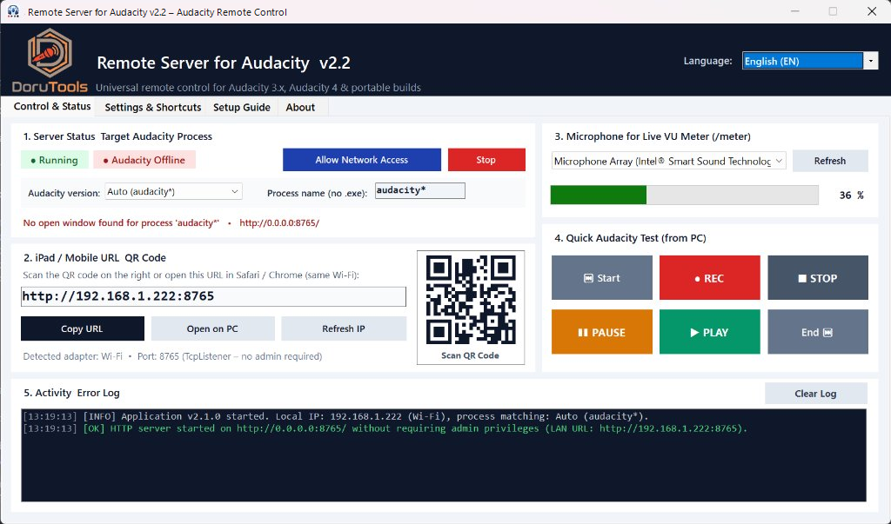

[🇬🇧 English](../README.md) | [🇨🇿 Čeština](README.cs.md) | [🇩🇪 Deutsch](README.de.md) | [🇪🇸 Español](README.es.md) | [🇫🇷 Français](README.fr.md) | [🇮🇹 Italiano](README.it.md) | [🇵🇱 Polski](README.pl.md) | [🇷🇴 Română](README.ro.md)

# Audacity Remote Server (DoruTools)

Kabellose WLAN-Fernbedienung für **Audacity 3.x**, **Audacity 4** und portable Versionen — Aufnahme, Pause, Wiedergabe und Live-VU-Meter direkt vom iPad oder Smartphone.

### [⬇ AudacityRemoteServer.exe herunterladen](https://github.com/DoruKosztner/AudacityRemoteServer-Releases/releases/latest/download/AudacityRemoteServer.exe) &nbsp;|&nbsp; [🌐 Interaktive Webseite](https://dorukosztner.github.io/AudacityRemoteServer-Releases/) &nbsp;|&nbsp; [Releases](https://github.com/DoruKosztner/AudacityRemoteServer-Releases/releases)

> [!NOTE]
> **Windows SmartScreen:** Da diese kostenlose App noch kein kostenpflichtiges Code-Signing-Zertifikat besitzt, zeigt Windows beim ersten Start eventuell *"Der Computer wurde durch Windows geschützt"*. Klicken Sie auf **Weitere Informationen** und dann auf **Trotzdem ausführen**.

---

## Screenshots

| PC-Server (Windows) | Mobile / iPad Web-Remote |
| :---: | :---: |
|  |  |

---

## Kurzanleitung

1. Laden Sie **AudacityRemoteServer.exe** herunter und starten Sie es.
2. Starten Sie **Audacity** manuell mit einem geöffneten Projekt.
3. Klicken Sie einmal auf **Netzwerkzugriff erlauben** (Port 8765 in der Firewall).
4. Scannen Sie den **QR-Code** im selben WLAN (http:// statt https://).

> ⚠ **Hinweis Audacity 4:** Tippen Sie vor jeder neuen Aufnahme auf **Ende (End)**!

---

## Musik unterstützen (Denie)

Entwickelt von einem Vater für seine Tochter, Sängerin **Denie**.

🔒 **Datenschutz:** Keine Telemetrie, keine Cloud — alles bleibt lokal im WLAN.

- **Instagram:** https://www.instagram.com/deniethesinger
- **TikTok:** https://www.tiktok.com/@denie.official
- **YouTube:** https://www.youtube.com/@denieofficial
- **Facebook:** https://www.facebook.com/Deniethesinger
- **Ko-fi:** https://ko-fi.com/deniethesinger

Freeware (closed source) — see [LICENSE](../LICENSE).