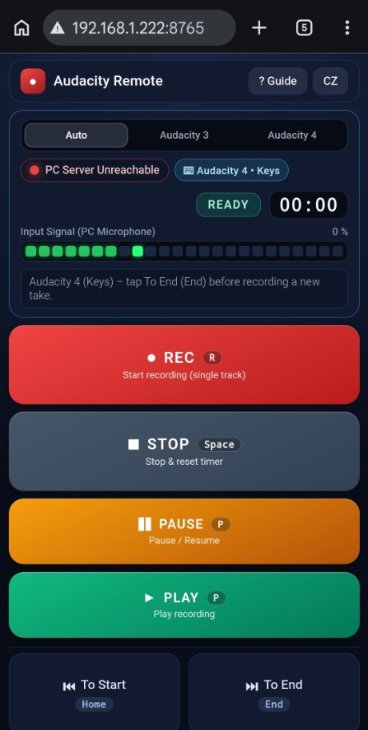

[🇬🇧 English](../README.md) | [🇨🇿 Čeština](README.cs.md) | [🇩🇪 Deutsch](README.de.md) | [🇪🇸 Español](README.es.md) | [🇫🇷 Français](README.fr.md) | [🇮🇹 Italiano](README.it.md) | [🇵🇱 Polski](README.pl.md) | [🇷🇴 Română](README.ro.md)

# Audacity Remote Server (DoruTools)

Bezprzewodowy pilot Wi-Fi dla **Audacity 3.x**, **Audacity 4** i wersji portable — nagrywanie, pauza, odtwarzanie i miernik VU na żywo z iPada lub telefonu.

### [⬇ Pobierz AudacityRemoteServer.exe](https://github.com/DoruKosztner/AudacityRemoteServer-Releases/releases/latest/download/AudacityRemoteServer.exe) &nbsp;|&nbsp; [🌐 Interaktywna strona WWW](https://dorukosztner.github.io/AudacityRemoteServer-Releases/) &nbsp;|&nbsp; [Releases](https://github.com/DoruKosztner/AudacityRemoteServer-Releases/releases)

---

## Zrzuty ekranu

| Serwer PC (Windows) | Pilot Mobilny / iPad |
| :---: | :---: |
|  |  |

---

## Szybka instrukcja

1. Pobierz i uruchom **AudacityRemoteServer.exe**.
2. Uruchom **Audacity** ręcznie z otwartym projektem.
3. Kliknij raz **Zezwól na dostęp sieciowy** (port 8765).
4. Zeskanuj **kod QR** w tej samej sieci Wi-Fi (http://).

> ⚠ **Uwaga Audacity 4:** Kliknij **Koniec (End)** przed nowym ujęciem!

---

## Wesprzyj muzykę Denie

Stworzone przez ojca dla jego córki, wokalistki **Denie**.

🔒 **Prywatność:** Brak telemetrii i chmury — wszystko zostaje w sieci lokalnej.

- **Instagram:** https://www.instagram.com/deniethesinger
- **TikTok:** https://www.tiktok.com/@denie.official
- **YouTube:** https://www.youtube.com/@denieofficial
- **Facebook:** https://www.facebook.com/Deniethesinger
- **Ko-fi:** https://ko-fi.com/deniethesinger

Freeware (closed source) — see [LICENSE](../LICENSE).